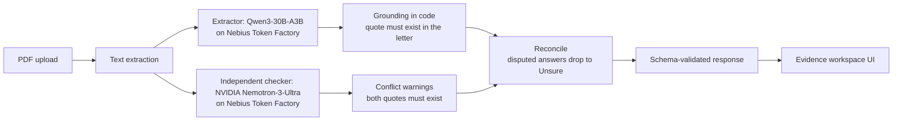

# Unsealed

**Plain-language answers about official letters, each one traced to the exact words on the page.**

Built in October 2026 for the Nebius x NVIDIA Global AI Hackathon, Best Apps and Agents track.

- **Live demo:** <DEMO_URL>
- **Demo video (under 3 minutes):** <VIDEO_URL>
- **Platform feedback for Nebius and NVIDIA:** [FEEDBACK.md](FEEDBACK.md)
- **Evaluation record:** [eval/results/](eval/results/), including the [preregistration for blind set C](eval/letters/blind-c/PREREGISTRATION.md)

---

## The problem

Tuition bills, court notices, collection letters and benefit decisions are written to be legally precise, not readable. Misreading one costs a missed deadline, a late fee, or a payment of the wrong amount.

A fluent summarizer makes this worse, because fluent is exactly how a wrong deadline gets believed. Unsealed answers four questions about a letter:

1. How much?
2. By when?
3. What do I have to do?
4. What happens if I don't?

It refuses to answer any of them unless it can point to the words in the letter that say so.

## What you see

Upload a PDF. You get one card per question, each marked **Verified**, **Unsure** or **Not found**. Verified answers carry the exact quoted passage, highlighted in the document beside the answer. If the letter contradicts itself, a warning appears above the results with both passages, each clickable to jump to its place in the letter. A short summary closes the page. If a letter's two halves disagree about an amount, Unsealed says so instead of choosing one.

No letter handy? Download the fictional sample from [public/samples/](public/samples/).

## Design principle: quote or abstain

The two kinds of error are not equal. A confident wrong answer about a deadline or an amount can cost the reader money. An "I'm not sure" costs a phone call. Everything below follows from treating those costs asymmetrically:

- **Grounding is enforced in code, not requested in a prompt.** A field is Verified only if its supporting quote is found in the letter's text. A model that invents a plausible quote gets Unsure.
- **A second, independent model reviews the letter.** The reviewer is a different model family from the extractor, so the extractor's mistakes are not repeated by its own reviewer.
- **Disputed values propagate.** When the letter contradicts itself, every answer that depends on the disputed passage drops to Unsure.
- **The reviewer fails loudly.** If the contradiction check cannot run or returns unusable output, the response says the check failed. It never reports a clean result for a check that did not finish.
- **Narrow prompts for the reviewer.** The checker is asked one question (do two passages give different answers about the amount, the date or the action?) and told to report nothing when unsure. Most letters contain no contradiction, and the prompt is written for that base rate.

## How it works



1. **Intake.** PDF only, up to 10 MB and 20,000 characters of text, extracted with `unpdf`. Non-PDF, empty and unreadable files are rejected with readable messages. Text extraction is the only step that touches the file itself.
2. **Extraction.** `Qwen/Qwen3-30B-A3B-Instruct-2507` at temperature 0 returns strict JSON: for each of the four fields, the value, an exact supporting quote, a confidence, and flags for conflicting or vague wording, plus a document type and a short summary. The prompt treats the letter as untrusted text, tells the model not to pick between conflicting values, and routes money the reader is owed (refunds, payouts) away from the "how much do I owe" field.
3. **Grounding** (`lib/verify.ts`). The quote is located in the letter with whitespace-insensitive matching. For amounts, the reported digits must also appear in the quote. Missing quotes, unlocatable quotes, conflict or vague flags and low confidence all produce Unsure, with a reason.
4. **Independent check** (`lib/contradictions.ts`), run in parallel with extraction. `nvidia/Nemotron-3-Ultra-550b-a55b` (thinking off, 6,000 max tokens) returns up to two contradictions as pairs of exact quotes, at most 30 words each. A contradiction is reported only if both quotes are found in the letter and do not overlap.
5. **Reconciliation** (`lib/explain.ts`). The answer a contradiction is about drops to Unsure. So does any Verified answer that repeats a disputed amount or date, and, for conflicts about what to do, any answer whose evidence is one of the disputed passages. If any warning fires, the summary ends with a note that the letter contradicts itself.
6. **Response.** The result is validated against a shared Zod schema (`lib/schema.ts`), with quote offsets that refer to the exact text returned, so the interface can highlight evidence precisely.
7. **Failure design.** The extraction retry budget (55 s) sits under the route limit (60 s). Internal errors are logged by name only, never with letter text, and the user sees a generic message.

## Hackathon requirements

| Requirement | How Unsealed meets it |
|---|---|
| Runs on Nebius Token Factory or AI Cloud | Every model call goes to Nebius Token Factory's chat completions endpoint. No other inference provider is used. |
| At least one NVIDIA open-source model | NVIDIA Nemotron-3-Ultra is the independent contradiction checker in the live pipeline. |
| Working, deployed application | <DEMO_URL>. The web app is on Vercel; all model inference is on Nebius Token Factory. |
| Repository, README, feedback | This repository, this README, and [FEEDBACK.md](FEEDBACK.md). |

## Model selection

Roles were assigned by measurement on the 15-letter development set (60 fields). That set is open-book, so we treat it as a way to compare models and then confirmed the choice on blind sets (below).

**Extractor** (one run per row unless stated):

| Model | Fields correct | Dangerous errors* |
|---|---|---|
| Qwen3-30B-A3B-Instruct-2507 | 56/60 | **0** in each of the last three runs |
| NVIDIA Nemotron Super | 55-56/60 over six runs | 1 in every run (an overclaim on the same letter) |
| NVIDIA Nemotron Ultra | 54/60 | 1 (an invented value shown as Verified) |
| NVIDIA Nemotron Nano, thinking on | 51/60 | 4 |
| NVIDIA Nemotron Nano, thinking off | 49/60 | 8 |

\* A dangerous error is a wrong or invented value presented as Verified.

Super was several times faster than Qwen (about 3 seconds per letter against 10 to 20), but it overclaimed a field in every run. We took the slower model with no dangerous errors and put the effort into the waiting experience instead.

**Checker** (the four dev letters with a real contradiction, thinking off):

| Model | Contradictions caught |
|---|---|
| Nemotron Ultra | 4/4 in every repeat run |
| Nemotron Nano | 2-4/4, varying run to run |
| Qwen3-30B-A3B | 3/4 |
| Nemotron Super | 1/4 |
| Nemotron Lightning | 0/4 |

Ultra's weakness was a false alarm on one dev letter in two of four runs. One added sentence in the checker prompt (leave out items you judge consistent) removed it: 8 of 8 runs caught 4/4 with no false alarms. That prompt change was tuned on a dev letter, so it is open-book evidence.

## Evaluation

Accuracy on a set you tuned against says little, so the evaluation is built around blind sets:

- **Separation of duties.** Muhammad wrote every blind letter and kept the answer key private. Rida built the system and ran it. The builder never saw a blind key before the run.
- **Run once, save first.** Each blind set is run once per code version. Raw outputs are committed before scoring, and first-run failures are kept in the record rather than overwritten.
- **Preregistered set C.** Its rules, the frozen backend commit, the model settings, the runner command and a SHA-256 for every letter were committed before the run (see [PREREGISTRATION.md](eval/letters/blind-c/PREREGISTRATION.md)). The private key's hash is published too, so anyone can check it was not edited after the run.

| Set | Letters | Role | Result |
|---|---|---|---|
| Dev, L01-L15 | 15 | Open-book, used to build | 54/60 fields at the last full run (Oct 14, before the post-C changes), 0 dangerous, 6 safe underclaims |
| Holdout, H01-H08 | 8 | First blind set (extractor plus a separate detector) | 31/32 strict |
| N01-N06 | 6 | Blind, run before the checker was wired in | 17/24 strict. Five fields were Verified despite conflicting evidence. This drove the pipeline in its current form. |
| B01-B08 | 8 | Frozen baseline for the current pipeline | 24/32 strict. Findings: one missed date conflict, a refund read as a debt, three false warnings. |
| C01-C08 | 8 | Preregistered, frozen at `5bf355a` | **27/32 (84.4%)**: 3 PASS, 3 SAFE, 2 FAIL |

Set C in detail, as scored by Muhammad against the frozen rubric: all Verified amounts and deadlines were correct, both expected contradictions were detected, and there were no false warnings. The two FAIL letters share one problem: when the checker found conflicting evidence, a disputed instruction or consequence was still presented too confidently, especially in the summary. Verdict definitions are in the preregistration.

**Post-C changes, not covered by any measurement.** After scoring we made hardening changes aimed at that failure: an unusable checker response now reports a failed check instead of a clean one, the summary carries a note whenever a conflict warning fires, and answers whose evidence is a disputed instruction passage drop to Unsure. They were spot-checked on earlier, non-blind letters. C was deliberately not re-run, because a better score on letters we have already seen would prove nothing. See the git log after commit `d98998d`.

**Integrity notes.**
- The frozen commit `5bf355a` no longer sits on the main branch, because history was rewritten on Oct 17 for the deployment reason described under Team. It is preserved by the tag `blind-c-freeze`, and the backend files are byte-identical to it up to the first post-C commit.
- A backend fix (`83c8d04`) landed after the C letters were handed over but before the run. The run used `5bf355a` and did not include it. Muhammad's audit keeps measured results separate from formal preregistration compliance, and [RUN-NOTES.md](eval/results/blind-c-run1/RUN-NOTES.md) lists every deviation.

## Known limitations

- **Digital PDFs only.** Scanned pages and photos need OCR, and the grounding step needs a real text layer. Input limits are 10 MB and 20,000 characters.
- **Contradiction checking covers amounts, dates and actions.** It can miss a conflict and can raise a false one (three false warnings on set B, none on set C). It is not a legal reading.
- **A consequence that depends on a disputed value can stay Verified.** The summary carries a caution, but the field itself is not downgraded. Widening the rule would downgrade correct answers, so we left it.
- **Only amounts are checked against their quote text.** For deadlines, actions and consequences, the quote is guaranteed to exist in the letter but not guaranteed to contain the reported value.
- **Money owed to the reader** (refunds, payouts) shows Not found for the amount field by design. The summary states the amount and direction. Showing direction as a field needs a schema change and is future work.
- **Latency is 10 to 25 seconds per letter.** Extraction dominates; the checker adds about a second and runs in parallel.
- **Results vary from run to run.** Hosted inference is not fully repeatable even at temperature 0, so a single run can move by a field or two. This is why blind sets are run once and reported as run.
- **Small, fictional test sets.** Eight letters and 32 fields per blind set describe failure modes and relative behavior. They are not a population accuracy estimate, and the dev set is open-book.
- **Not legal, financial or professional advice.** Unsealed explains what a letter says. It does not tell anyone what to do about it.

## Privacy

Letter text is sent to models hosted on Nebius Token Factory (Qwen and NVIDIA Nemotron) to produce the answers. The server has no database and keeps no copy of uploads. Server logs record error names only, never letter contents. The repository contains only fictional or public letters. See the in-app Privacy and Terms pages.

## Run it yourself

```bash
git clone https://github.com/ridacyber/unsealed.git
cd unsealed
npm install
cp .env.example .env     # then fill in your Nebius Token Factory key and model IDs
npm run dev              # http://localhost:3000
```

| Variable | Purpose |
|---|---|
| `LLM_API_KEY`, `LLM_BASE_URL` | Nebius Token Factory credentials and endpoint |
| `LLM_MODEL` | Extractor model, `Qwen/Qwen3-30B-A3B-Instruct-2507` |
| `CHECK_MODEL` | Checker model, `nvidia/Nemotron-3-Ultra-550b-a55b` (falls back to `LLM_MODEL`) |
| `CHECK_MAX_TOKENS`, `CHECK_EXTRA_BODY` | Checker settings: `6000` and `{"chat_template_kwargs":{"enable_thinking":false}}` |
| `LLM_MAX_TOKENS`, `LLM_EXTRA_BODY` | Optional extractor equivalents |
| `LLM_INPUT_USD_PER_M`, `LLM_OUTPUT_USD_PER_M` | Optional, for cost reporting in the response metrics |

Checks:

```bash
npx tsc --noEmit && npx eslint . && npm run build
npx tsx --test components/lib/citation.test.ts     # each frontend test file lists its own run command
npx tsx scripts/check-offsets.ts                   # quote offsets agree with the letter text
npx tsx scripts/run-holdout.ts <letters-folder> [file-prefix]   # relative folder; writes a CSV and JSON to /tmp
```

`eval/run-eval.ts` scores the development letters against `eval/answer-key.csv`.

## Repository map

```
app/api/analyze/route.ts        POST endpoint (backend)
app/page.tsx, layout.tsx, results/    pages (frontend)
app/privacy/, app/terms/        legal pages (text by the backend owner, styling by the frontend owner)
components/                     interface, hooks, citation and sample logic, unit tests (frontend)
lib/explain.ts                  extraction prompt, reconciliation, response assembly
lib/verify.ts                   quote location and per-field grounding
lib/contradictions.ts           independent checker
lib/extract.ts                  PDF text extraction
lib/llmOptions.ts               per-role model settings
lib/schema.ts                   shared contract (Zod), changed only by agreement
scripts/                        evaluation runners and regression checks
eval/letters/                   fictional test letters: dev, holdout, blind sets
eval/results/                   saved run outputs and preregistrations
public/samples/                 fictional sample letter PDF
OWNERS.md                       who owns which files
```

## Team

Two authors, two lanes, agreed up front and written down in [OWNERS.md](OWNERS.md).

| | Rida Rahim ([@ridacyber](https://github.com/ridacyber)) | Muhammad Bin Zeeshan ([@muhamzes](https://github.com/muhamzes)) |
|---|---|---|
| Owns | Backend and platform: `app/api/`, `lib/`, `scripts/`, the evaluation harness, deployment | **All frontend and design:** landing and upload, results and evidence workspace, waiting, failure and recovery screens, contradiction banner, samples, accessibility |
| Also | Model selection, prompts, grounding and checker logic, running the blind sets | Wrote the development and blind test letters, scored every blind set against a private key, demo letters and video script |

The interface was designed and built by Muhammad. The only frontend-lane changes that are Rida's own are the initial Next.js scaffold, the one-line switch that turns on the live API, and the text of the Privacy and Terms pages (styled by Muhammad). Everything that decides what a user is told was built by Rida, and Muhammad's commits touch nothing in `app/api/`, `lib/` or `scripts/` (`git log --author=Muhammad -- app/api lib scripts` prints nothing).

### A note on commit authorship

Unsealed is deployed on Vercel's free Hobby plan, which builds only commits authored by the account that owns the project. Muhammad's commits were rejected at deploy time, so to ship his frontend some of his commits were re-committed under Rida's account. This is visible in `git log` and GitHub's contributor graph. Three frontend commits show Rida as the author although Muhammad wrote them: the waiting, failure and recovery screens (`ff1cbdc`), the copy and social-sharing metadata (`ae2f6fa`), and the keyboard-accessible letter panel (`976a59f`). The last one carries a `Co-authored-by` trailer and says so in its message. History was rewritten on Oct 15 and Oct 17 to re-author the first two.

**Do not read authorship off the commit author field.** The reliable record is [OWNERS.md](OWNERS.md), the `frontend` and `backend` scopes in commit messages, and the table above.

This is the part of the workflow we would change. Deploying from a plan with team seats, or from pull requests merged by the project owner, would let each author's commits keep their own name.

### AI-assisted development

The running product uses no Anthropic or OpenAI models: every model call goes to Qwen or NVIDIA Nemotron on Nebius Token Factory. During development both authors used an AI coding assistant (Claude) for implementation help, debugging and drafting. Product decisions, the evaluation protocol and every reported number are ours, and the numbers are copied from saved run outputs. The repository contained assistant configuration files (`CLAUDE.md` and `AGENTS.md`). They are development tooling, not part of the product, and were removed before submission in commit `<REMOVAL_COMMIT>`. They remain visible in git history.

## License

MIT. See [LICENSE](LICENSE).
